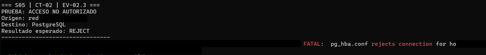
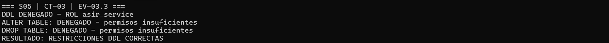
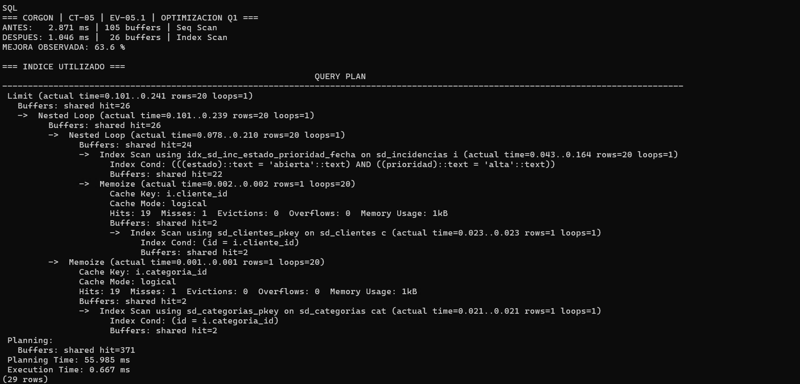

# PostgreSQL Administration, Security & Optimization Lab

**Linux | PostgreSQL 17 | Docker | Database Security | SQL Performance**

## Project Overview

This project documents the administration, security hardening and performance optimization of a PostgreSQL 17 database running in a Docker-based Linux laboratory.

The main objective was to improve database isolation, restrict unauthorized access, implement the principle of least privilege and analyze SQL query execution plans.

Developed as part of my second-year practical training in Network Computer Systems Administration (ASIR).

## Technologies

- Ubuntu Server LTS
- PostgreSQL 17
- Docker and Docker Compose
- SQL
- SCRAM-SHA-256 authentication
- `pg_hba.conf`
- PostgreSQL roles and privileges
- `EXPLAIN (ANALYZE, BUFFERS)`
- `pg_dump` and `pg_restore`
- Linux CLI and Bash

## Technical Implementation

### 1. Docker Isolation and Data Persistence

- PostgreSQL deployed in a private Docker network.
- Database port 5432 not published to the host.
- Persistent storage using a Docker volume.
- Resource limits applied to the database container.
- Controlled container recreation without deleting persistent data.
- Logical backup created using `pg_dump -Fc`.

Database persistence was verified by comparing the PostgreSQL system identifier and reference record counts before and after container recreation.

The backup format and contents were inspected, but a complete restore test was not performed.

### 2. Connection Security with pg_hba.conf

The initial connection policy was reviewed and replaced with more restrictive access rules.

Security measures included:

- SCRAM-SHA-256 authentication.
- Explicit authorization of the internal Docker network.
- Local IPv4/IPv6 connection rules.
- Rejection of unauthorized network origins.
- Configuration reload without restarting PostgreSQL.

A temporary isolated test network was used to verify that PostgreSQL explicitly rejected connections from unauthorized origins.

### 3. Role-Based Access Control

Database permissions were separated according to the principle of least privilege.

| Role | Purpose |
|---|---|
| Administrative role | Database administration and recovery |
| DDL role | Ownership and structural changes |
| Application/service role | Restricted data access and DML operations |

The restricted service role was validated through successful SELECT, INSERT, UPDATE and DELETE operations.

Unauthorized ALTER TABLE and DROP TABLE operations were rejected by PostgreSQL.

Test transactions were rolled back to preserve the original data.

### 4. Memory and Connection Tuning

PostgreSQL parameters were adjusted for a container with a 512 MiB memory limit.

| Parameter | Before | After |
|---|---:|---:|
| max_connections | 100 | 30 |
| shared_buffers | 128 MB | 64 MB |
| work_mem | 4 MB | 2 MB |

The effective settings were confirmed using PostgreSQL system views.

A controlled concurrency test completed 60 SQL queries across two concurrent connections without errors.

These settings were selected for a resource-constrained laboratory. They do not constitute general-purpose production recommendations.

### 5. SQL Query Optimization

Three SQL queries were evaluated using:

```sql
EXPLAIN (ANALYZE, BUFFERS)
```

The analysis included execution time, buffer usage, scan types, joins, aggregations and index effectiveness.

#### Query 1 — Filtered incident search

- Execution time: 2.871 ms → 1.046 ms.
- Shared buffers: 105 → 26.
- Execution plan changed from Sequential Scan to Index Scan.
- Observed improvement: approximately 63.6%.

#### Query 2 — Temporal aggregation

- Execution time: 3.006 ms → 2.408 ms.
- Shared buffers: 93 → 80.
- Bitmap Index Scan used.
- Observed improvement: approximately 19.9%.

#### Query 3 — Multi-table aggregation

- Execution time: 7.909 ms → 8.938 ms.
- Shared buffers: 98 → 98.
- The tested partial index was not selected.
- The execution plan continued using Sequential Scan.

**Key finding:** Not every index improves query performance. The third query demonstrated the importance of evaluating actual execution plans rather than assuming that adding an index will always reduce execution time.

These measurements come from specific laboratory executions and are not statistical averages or production benchmarks.

### 6. Final Validation

The final checks verified:

- PostgreSQL connectivity and service health.
- Private Docker network isolation.
- SCRAM-SHA-256 authentication.
- Restricted SQL role permissions.
- Effective memory and connection parameters.
- Successful concurrent SQL operations.
- Query execution plans and index behavior.
- Persistent database storage.

## Skills Demonstrated

- Linux server administration.
- PostgreSQL deployment and configuration.
- Docker networking and persistent volumes.
- Database access control and authentication.
- Role-based privilege management.
- SQL query optimization.
- Performance troubleshooting.
- Backup procedures.
- Technical validation and documentation.

## Technical Evidence

The following screenshots were captured during the PostgreSQL 17 laboratory and sanitized for public documentation.

### 1. PostgreSQL Connection Access Control

**Validation:** Unauthorized connections rejected by `pg_hba.conf`.

A temporary test network was used to verify that PostgreSQL actively rejected connections from an unauthorized source.



### 2. Least-Privilege Role Enforcement

**Validation:** Unauthorized DDL operations rejected.

The restricted database role successfully performed permitted data operations but was prevented from modifying or deleting table structures.

The laboratory verified that `ALTER TABLE` and `DROP TABLE` were denied.



### 3. SQL Query Optimization

**Validation:** Index selection and query performance analysis.

The first optimization test demonstrated a change from Sequential Scan to Index Scan.

Recorded execution time decreased from 2.871 ms to 1.046 ms, with shared buffer usage reduced from 105 to 26.

These values represent individual laboratory executions rather than averaged performance benchmarks.



For additional results, including an unsuccessful index optimization attempt, see [Query Performance Analysis](docs/query-performance.md).

## Security and Privacy

This public repository contains sanitized educational examples and documentation.

Operational database credentials, real infrastructure addresses, production-style data, private application code and database backups are intentionally excluded.

## Author

**Erick Conesa Pérez**

Second-year student — Higher Vocational Training in Network Computer Systems Administration (ASIR).

Professional interests: Linux administration, IT infrastructure, database systems, networking and security.
